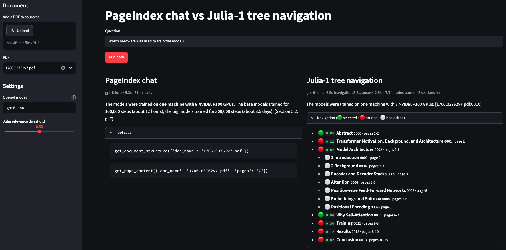

# tinycrag (tiny Classifier for RAG)

A small Python library in `tinycrag/`, with a Streamlit UI in `app.py`. [PageIndex](https://github.com/VectifyAI/PageIndex) turns each PDF into a tree of sections. The local [Julia-1](https://huggingface.co/SupersonicLabs/Julia-1) decision model then navigates that tree top-down, deciding at each section whether it is relevant to the query and worth descending into. An OpenAI model answers from the sections Julia selects. The UI compares this side by side with PageIndex's own chat, where an LLM agent searches the same tree.

This project is inspired by [Jev](https://typesafe.ai/blog/introducing-system-one-models-and-jev), a decision model from TypeSafe. Jev takes a shared piece of context and a typed question (pick one option, rate on a scale, or answer yes/no) and returns probabilities rather than generated text. I wanted to see how that style of judgment fits retrieval-augmented generation (RAG). Instead of embedding documents and ranking them by vector similarity, or letting an LLM agent decide where to read, each section is treated as the context and the query as a yes/no question: "is this section relevant?" The model returns a probability, and a threshold decides what to keep.

## Example

**Note: Julia-1 timing is computed on CPU.**



## Setup

Python 3.14+ and [uv](https://docs.astral.sh/uv/) are required by this project. The `Julia-1/` directory must contain both the model's Python package and the actual checkpoint weights (not Git LFS pointers). The existing local checkout is used as an editable uv workspace dependency.

For a fresh checkout, download the model first:

```bash
uv run --no-project --with huggingface-hub python -c "from huggingface_hub import snapshot_download; snapshot_download('SupersonicLabs/Julia-1', local_dir='Julia-1')"
uv sync
```

If `Julia-1/` is already present, just run `uv sync`. Julia inference runs locally on CPU by default.

Put your OpenAI key in a `.env` file at the project root:

```
OPENAI_API_KEY=...
```

## Run the comparison UI

```bash
uv run --group ui streamlit run app.py
```

1. Pick a PDF from `sources/` or upload one.
2. Click **Build tree** the first time you use a PDF. PageIndex indexes it locally: the tree comes from the PDF layout, and the OpenAI model writes a summary for every section and refines the tree. Trees are stored in `.pageindex/` (gitignored) and reused by file name, so each PDF is indexed once.
3. Ask a question and click **Run both**.

One OpenAI model, `gpt-6-luna` by default, is used everywhere: to build new trees, for PageIndex chat, and to write the Julia column's answer. The sidebar sets the model and the Julia threshold. Changing the model doesn't rebuild existing trees.

Both columns search the same tree with the same model, so the comparison is about how each one decides where to read:

- **PageIndex chat:** PageIndex's agentic chat. The model reads the tree and calls tools to fetch the pages it needs, then answers. The column lists its tool calls.
- **Julia-1 tree navigation:** Julia scores the top-level sections against the query. Each section is shown to Julia as its title, page range and PageIndex summary, which describes the whole subtree. Julia descends only into the children of sections that reach the threshold, so a rejected section prunes everything under it. The own text of every selected section (the text not held by its children) goes to the model in document order, tagged `[file.pdf:node_id]` for citations. The column shows the tree with each section's score (🟢 selected, 🔴 pruned, ⚪ never visited) and the exact context sent to the model.

The score is Julia's softmax probability for `relevant`, not a calibrated measure of retrieval quality. Pruning is strict, so a parent scored just under the threshold hides all its subsections, even relevant ones. If an answer misses something, check the navigation tree and try a lower threshold.

## Python API

All public classes are available from `tinycrag`. Importing the package does not load PageIndex, PyTorch, or model weights.

```python
from dotenv import load_dotenv

from tinycrag import (
    JuliaRetriever,
    JuliaTreeNavigator,
    OpenAIAnswerer,
    PageIndexDocuments,
)

load_dotenv(".env")
query = "How does multi-head attention work?"

documents = PageIndexDocuments(".pageindex")  # gpt-6-luna for indexing and chat
doc_id = documents.index("sources/paper.pdf")  # reuses an existing tree by file name
roots = documents.tree(doc_id)

navigation = JuliaTreeNavigator(JuliaRetriever("Julia-1")).navigate(
    roots, query, threshold=0.5
)
print(OpenAIAnswerer("gpt-6-luna").answer(query, navigation.passages()))

print(documents.chat(query, doc_id).answer)  # PageIndex's own chat, for comparison
```

`GeminiAnswerer` has the same `answer(query, passages)` interface if you want to answer with Gemini instead. It uses Vertex AI by default (Application Default Credentials, plus `GOOGLE_CLOUD_PROJECT` and `GOOGLE_CLOUD_LOCATION`); pass `enterprise=False` to use a Gemini API key.

| Class | Responsibility |
| --- | --- |
| `PageIndexDocuments` | Index PDFs into local PageIndex trees, load them as `TreeNode`s, and run PageIndex chat. |
| `JuliaTreeNavigator` | Navigate trees level by level with Julia, returning a `TreeRetrievalResult` of `NodeDecision`s. |
| `JuliaRetriever` | Lazily load Julia once and score text for relevance to a query. |
| `OpenAIAnswerer`, `GeminiAnswerer` | Answer a query from tagged `Passage`s, citing them by tag. |
| `PageIndexAnswer`, `ToolCall` | PageIndex chat's answer, model, timing and tool calls. |
| `TreeNode`, `NodeDecision`, `TreeRetrievalResult`, `Passage` | Immutable data objects for tree sections, decisions, and answer context. |

Julia uses strict encoding with an 8,192-token context and a 512-token question/options budget, so oversized inputs fail rather than being silently truncated. Sections without a PageIndex summary are judged on the first 400 words of their own text. The library's default Julia path is `Julia-1/` relative to the working directory. `JuliaRetriever(engine=...)` accepts any object implementing the exported `DecisionEngine` protocol, for reuse or testing. Library classes emit standard Python logging records.

## Development

Ruff checks include imports, common Python errors, and Google-style docstrings. The downloaded `Julia-1/` dependency is excluded from project linting.

```bash
uv run ruff check .
uv run ruff format --check .
uv run python -m unittest discover -s tests -v
```

To apply formatting, run `uv run ruff format .`. The offline tests cover Julia scoring and model reuse, tree navigation and pruning, and answer prompts, without loading real weights or calling any API.
